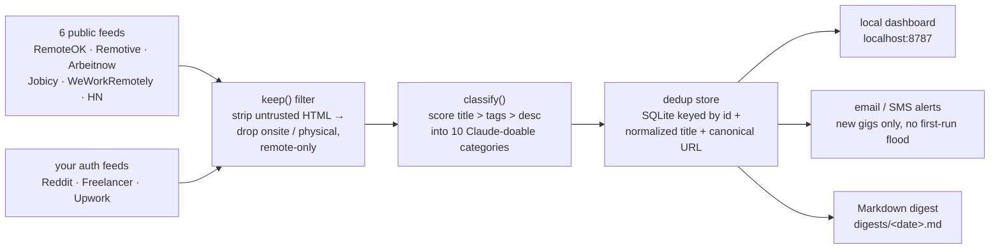

# Gig Radar

[](https://github.com/divshettyy/gig-radar/actions/workflows/ci.yml)
[](LICENSE)
[](requirements.txt)

**Find freelance work you can actually deliver with Claude — fast.** Gig Radar pulls remote, worldwide-eligible gigs (open to India and anywhere else) from a dozen job feeds, strips out the onsite/physical roles, scores each listing into a Claude-doable work category, dedupes the same gig across feeds, and pings you by email/SMS the moment a new one lands.

**▶ Live demo (no install, no account):** **[open the public dashboard artifact](https://claude.ai/artifact/4AD45Vbehy3qP1qQFVdNNp)** — 6 CORS-open public feeds + a directory of 40+ freelance/gig portals, read-only and safe to share.

Gig Radar is split into two parts:

- **Frontend (public, read-only):** the shareable dashboard above — 6 public remote-job feeds and the 40+ portal directory, no account, no secrets.
- **Backend (this repo):** a small local Flask service that polls those same public feeds *and* your own authenticated accounts (Reddit r/forhire, Freelancer.com, optionally Upwork), dedupes everything into a local SQLite database, serves its own richer dashboard at `http://localhost:8787`, and fires an **email and/or SMS alert** on new gigs. All credentials stay in a local `.env` file and never leave the machine.

## How it works



## Features

| Capability | What it does |
|---|---|
| **6 zero-config public feeds** | RemoteOK, Remotive, Arbeitnow, Jobicy, We Work Remotely, Hacker News "Who is hiring" — work with an empty `.env` |
| **Optional authenticated feeds** | Reddit r/forhire (`[Hiring]`/`[Task]`), Freelancer.com, Upwork (best-effort, gated API) via your own tokens |
| **Claude-doable classification** | Keyword scoring weighted title > tags > description into 10 AI-workable categories (AI/chatbot, writing, coding, data, SEO, decks, translation, spreadsheets, marketing, admin) |
| **Remote + signal filter** | Drops onsite and physical/non-remote roles automatically; tuned against false negatives |
| **Cross-feed dedup** | SQLite store keyed by id, normalized `(company, title)` and canonical URL — the same gig cross-posted to 3 feeds shows once |
| **New-gig alerts** | Email (Gmail SMTP) and/or SMS (Twilio); no first-run flood, safe no-ops when unconfigured |
| **40+ portal directory** | A hand-curated list of freelance/gig platforms (incl. ones with no API) surfaced in the dashboard's Platforms tab, so nothing pollable *or* manual slips past you |
| **Standalone Markdown digest** | `digest.py` writes a dated digest from public feeds only — no secrets, cron/cloud friendly |
| **Runs 24/7** | `run.sh` venv bootstrap, or a systemd unit for boot start on Linux/WSL2 |

## Tech stack

- **Backend:** Python 3, Flask, `requests`, `python-dotenv`, SQLite (stdlib `sqlite3`)
- **Frontend:** single static `dashboard.html` served by Flask (no build step, no JS framework)
- **Alerts:** Gmail SMTP (`smtplib`), Twilio REST API
- **Process management:** `run.sh` (venv bootstrap) or systemd (`gig-radar.service`)

## Prerequisites

- Python 3.9+
- `pip` / `venv` (standard library `venv` module)
- A Gmail account with an App Password, and/or a Twilio account, if you want alerts (both optional)
- Linux/WSL2 if you want the systemd auto-start service (optional)

## Install & run

```bash
git clone https://github.com/divshettyy/gig-radar.git
cd gig-radar
cp .env.example .env        # then edit .env — every field is optional
./run.sh                    # first run creates venv/ and installs requirements.txt, then serves
```

Open **http://localhost:8787**.

With an empty `.env` the 6 public feeds work immediately — add tokens to unlock the authenticated feeds and alerts.

`run.sh` is idempotent: it only builds the venv on first run, then just starts `server.py`.

## Configuration (environment variables)

All variables are optional and documented with setup links in `.env.example`. Names only — never commit real values:

| Variable | Used for | Required for |
|---|---|---|
| `POLL_INTERVAL` | Seconds between poll cycles (min enforced: 300) | Tuning only, default `1200` |
| `PORT` | Local dashboard port | Tuning only, default `8787` |
| `SMTP_USER` | Gmail address used to send alerts | Email alerts |
| `SMTP_APP_PASSWORD` | Gmail **App Password** (not your real password) | Email alerts |
| `NOTIFY_EMAIL_TO` | Address alerts are sent to (defaults to `SMTP_USER`) | Email alerts |
| `TWILIO_SID` | Twilio Account SID | SMS alerts |
| `TWILIO_AUTH_TOKEN` | Twilio Auth Token | SMS alerts |
| `TWILIO_FROM` | Twilio sending number | SMS alerts |
| `TWILIO_TO` | Your phone number to receive SMS | SMS alerts |
| `REDDIT_CLIENT_ID` | Reddit "script" app client id | Reddit r/forhire feed |
| `REDDIT_CLIENT_SECRET` | Reddit "script" app secret | Reddit r/forhire feed |
| `FREELANCER_OAUTH_TOKEN` | Freelancer.com OAuth token | Freelancer.com feed |
| `UPWORK_ACCESS_TOKEN` | Upwork OAuth2 access token (gated, advanced) | Upwork feed (best-effort) |

### Email alerts (Gmail)
1. Turn on 2-Step Verification on the Google account.
2. Create an **App Password**: https://myaccount.google.com/apppasswords
3. Put the 16-char app password + your address in `.env` (`SMTP_USER`, `SMTP_APP_PASSWORD`, `NOTIFY_EMAIL_TO`).

> Use an **App Password**, never your real Google password.

### SMS alerts (optional, Twilio free trial)
Sign up at https://www.twilio.com/try-twilio, then copy your Account SID, Auth Token, and trial "from" number into `.env` (`TWILIO_*`). Trial accounts can only text your own verified number.

### Reddit (optional)
https://www.reddit.com/prefs/apps → **create app** → type **script**. Copy the client id (under the app name) and secret into `REDDIT_CLIENT_ID` / `REDDIT_CLIENT_SECRET`. Read-only, app-only — no account password is stored.

### Freelancer.com (optional)
https://accounts.freelancer.com/settings/develop → generate an OAuth token → `FREELANCER_OAUTH_TOKEN`.

### Upwork (optional, advanced)
Upwork's public API needs an approved key + OAuth2; access is gated and often not granted to individuals. If you obtain an access token, paste it into `UPWORK_ACCESS_TOKEN` — if it fails, Upwork is skipped automatically.

Platforms with **no public job-search API** (Fiverr, Outlier, Internshala, most microtask sites) can't be polled this way — open those in the Platforms tab of the dashboard and check them manually.

## Usage

Run it in the background:
```bash
nohup ./run.sh > gigradar.log 2>&1 &
```

Or run one poll cycle from cron without the web server:
```bash
# every 20 min
*/20 * * * * cd ~/gig-radar && ./venv/bin/python poller.py >> gigradar.log 2>&1
```

Generate a standalone Markdown digest (no secrets needed, public feeds only):
```bash
./venv/bin/python digest.py   # writes digests/<UTC-date>.md
```

## Security

This has been reviewed for the risks that matter for a credential-holding
local service:
- **No committed secrets.** `.env` (and the DB/logs/venv) are git-ignored and
  were never tracked; only `.env.example` with empty placeholder values is in
  the repo. There is no real token, password, or phone number anywhere in the
  current tree or git history.
- **No SSRF surface.** Every outbound request target in `sources.py` is a
  hardcoded API/feed URL baked into the source — the app never fetches a URL
  supplied by a user, job listing, or request parameter, so there's nothing
  to allowlist.
- **No stored/DOM XSS.** Third-party job titles/descriptions/tags are
  untrusted by design (see `sources.py` docstring) and the dashboard
  (`dashboard.html`) only ever writes them via `el()`/`textContent`, never
  `innerHTML`, so a malicious listing can't inject script into the page.
  Links are set via the `href` property, not interpolated into markup.
- **Local-only web surface.** `server.py` binds Flask to `127.0.0.1` only; the
  dashboard and its `/api/*` routes (including the no-auth `POST
  /api/refresh`) are never reachable from the network, so the lack of
  auth/CSRF tokens on them is intentional, not an oversight.
- **Templating is plain text.** Email/SMS bodies (`notify.py`) are built with
  `%`-formatting into a `MIMEText` plaintext message and a size-capped SMS
  body — no HTML/template-injection surface in the alert path.
- **RSS parsing.** `sources.py` parses the We Work Remotely feed with
  `xml.etree.ElementTree`, which does not resolve external entities, so it
  isn't exposed to classic XXE.

Residual, accepted risk: Reddit/Freelancer/Upwork calls send your token or
app credentials over HTTPS to each platform's own API — that's inherent to
"authenticated feeds," not a bug, and is why those three are opt-in.

### Run 24/7 on boot (systemd, Linux/WSL2)

```bash
sudo bash ~/gig-radar/install-service.sh
```

Starts automatically on boot and restarts on crash. Manage it:
```bash
systemctl status gig-radar      # health
journalctl -u gig-radar -f      # live logs
sudo systemctl restart gig-radar
sudo systemctl disable --now gig-radar   # turn off
```

On WSL2, a systemd service only runs while the distro is running. To start WSL itself at Windows logon (run in PowerShell, not WSL):
```powershell
schtasks /create /tn "WSL Gig Radar" /tr "wsl.exe -d Ubuntu -e true" /sc onlogon /rl highest
```
Replace `Ubuntu` with your distro name from `wsl -l -q`.

## Safety notes

- Never share your `.env`. It is git-ignored.
- All job text is treated as untrusted and shown as plain text; it is never fed to an LLM.
- Respect each platform's rate limits and terms. This tool reads your own feeds; it does not scrape behind logins with your password.
- Listings and pay figures are third-party — verify on the source before applying or paying. Never pay a "training fee".

## Roadmap

- [x] Test coverage for sources, store, poller, notify, digest and the local API (137 tests)
- [ ] Pluggable notification channels (Slack/Discord webhook, Pushover)
- [ ] Per-domain alert filtering (only notify for selected categories)
- [ ] Dockerfile for one-command deploy off WSL/systemd
- [ ] Retry/backoff for flaky upstream feeds instead of a single try per cycle

## Known limitations

- Tests (`pip install -r requirements-dev.txt && python -m pytest -q`) use canned feed replies and fake mail/SMS; the browser code in `dashboard.html`, the shell scripts and the live feeds are untested.
- The onsite/physical filter still drops a few remote tech gigs that use a physical-role word ("Chef" the DevOps tool, "game mechanics").
- Network errors from a single source are caught and logged but not retried within the same cycle.
- SQLite file (`gigradar.db`) is local-only and not backed up; deleting it just re-seeds from the feeds.
- `.env` must be created manually from `.env.example`; there is no setup wizard.

## License

MIT — see [LICENSE](LICENSE).
